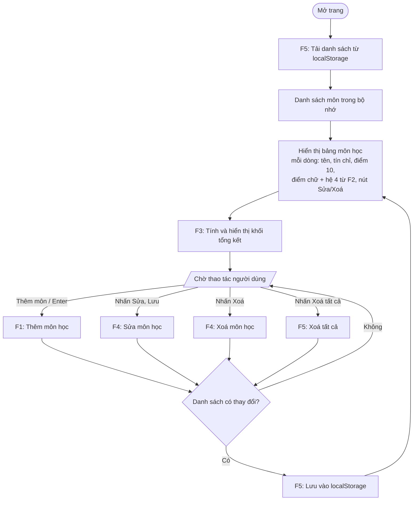
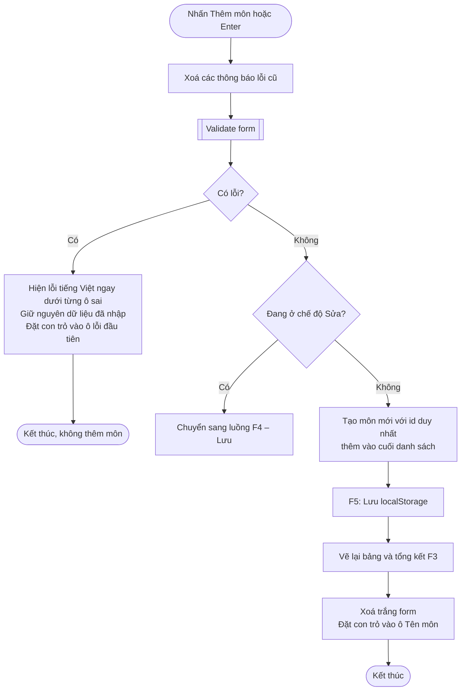
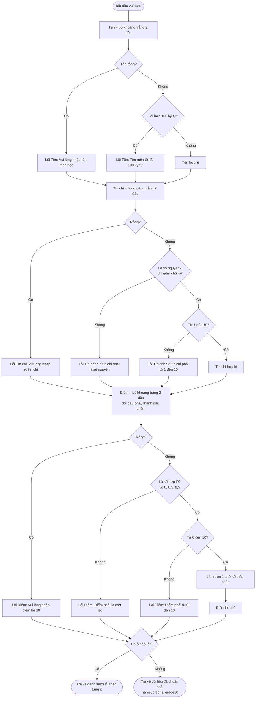
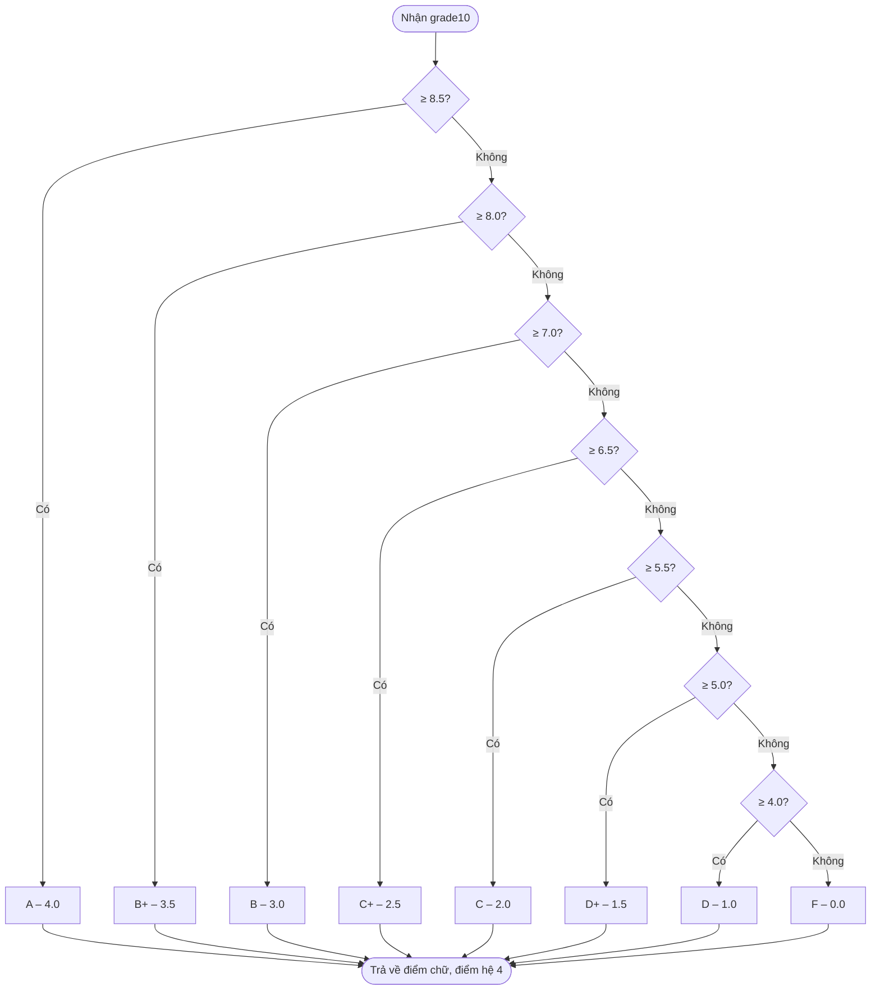
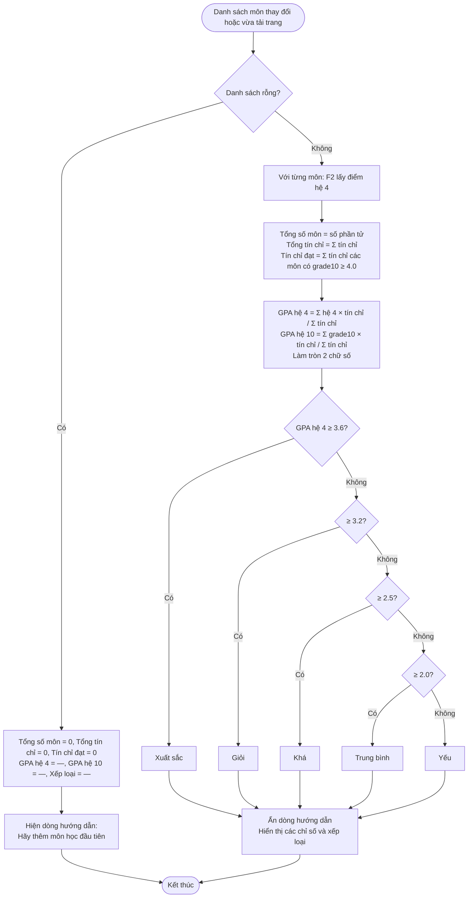
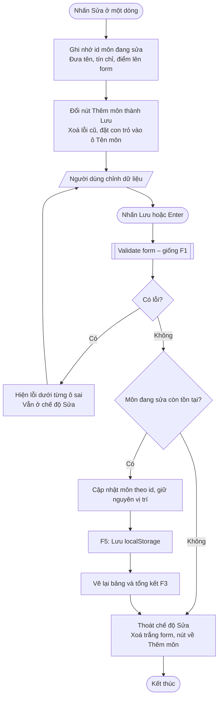
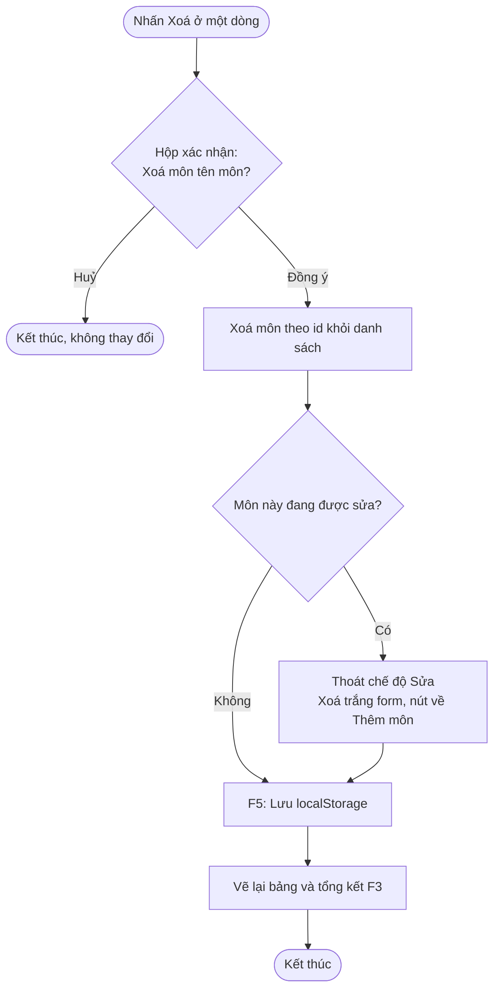
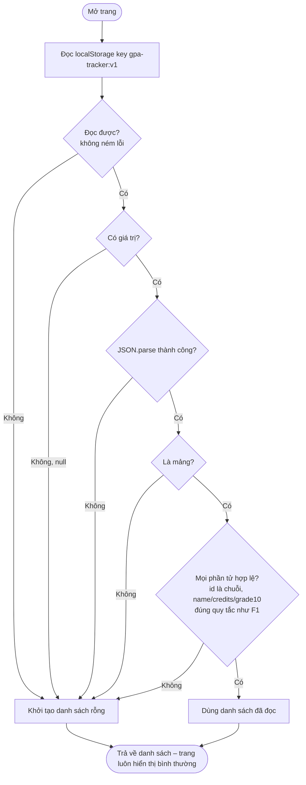
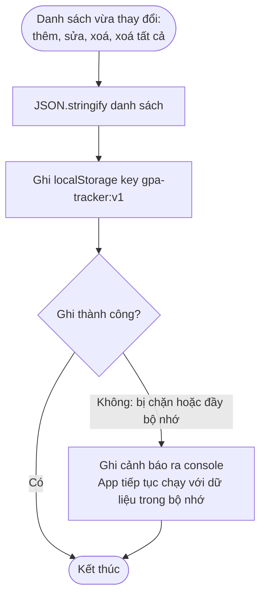
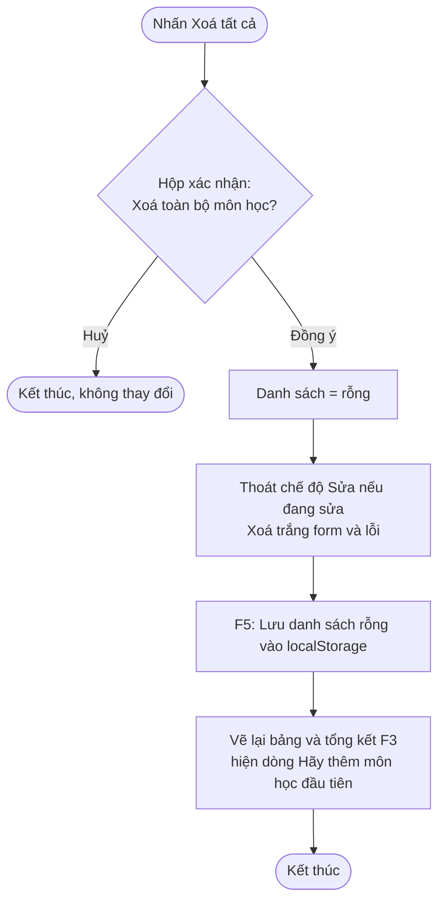

# Luồng nghiệp vụ – GPA Tracker

Flowchart cho từng chức năng trong `PRD.md`, viết bằng Mermaid. Code ở giai đoạn 3 phải bám theo
các luồng này. Các quy ước chi tiết (khi PRD chưa nói rõ) nằm ở mục cuối "Quy ước diễn giải PRD".

Cấu trúc dữ liệu một môn học:

```
{ id: string, name: string, credits: number (1–10), grade10: number (0–10, 1 chữ số thập phân) }
```

Điểm chữ và điểm hệ 4 không lưu, luôn tính lại từ `grade10` bằng F2.

---

## 0. Luồng tổng quan



---

## F1. Thêm môn học

Bước kiểm tra dữ liệu (khối "Validate form") dùng chung cho F1 và F4.



### Validate form (kiểm tra cả 3 ô, gom hết lỗi rồi mới hiển thị)



---

## F2. Quy đổi điểm

Đầu vào là `grade10` đã làm tròn 1 chữ số, nên các khoảng trong PRD (vd 8.0–8.4 và 8.5–10)
không có khe hở. So sánh từ trên xuống, gặp điều kiện đúng đầu tiên thì dừng.



---

## F3. Tính GPA và xếp loại



---

## F4. Sửa và xoá môn học

### Sửa môn



### Xoá môn



---

## F5. Lưu dữ liệu

### Tải dữ liệu khi mở trang



### Lưu dữ liệu sau mỗi thay đổi



### Xoá tất cả



---

## Quy ước diễn giải PRD

Những điểm PRD chưa nói rõ, được chốt như sau (không thêm chức năng mới):

1. **Validate gom lỗi:** kiểm tra cả 3 ô một lần và hiện mọi lỗi cùng lúc, không dừng ở lỗi đầu tiên.
2. **Thứ tự kiểm tra điểm:** kiểm tra khoảng 0–10 trên giá trị người dùng nhập, sau đó mới làm tròn
   1 chữ số (vd `10.04` báo lỗi, không làm tròn thành `10.0`).
3. **Tín chỉ:** chỉ nhận chuỗi chữ số (vd `3`); `3.0`, `3,5`, `2e1` đều báo lỗi "phải là số nguyên".
4. **Tín chỉ đạt:** "điểm ≥ 4.0" hiểu là điểm hệ 10 ≥ 4.0, tức là môn không bị điểm F.
5. **Xếp loại:** dựa trên GPA hệ 4 đã làm tròn 2 chữ số (giá trị hiển thị cho người dùng).
6. **Dữ liệu hỏng:** chỉ cần một phần tử sai là coi cả dữ liệu hỏng và khởi tạo danh sách rỗng,
   đúng như PRD ghi.
7. **Ghi localStorage lỗi:** PRD không quy định thông báo, nên chỉ ghi cảnh báo ra console và app vẫn chạy.
